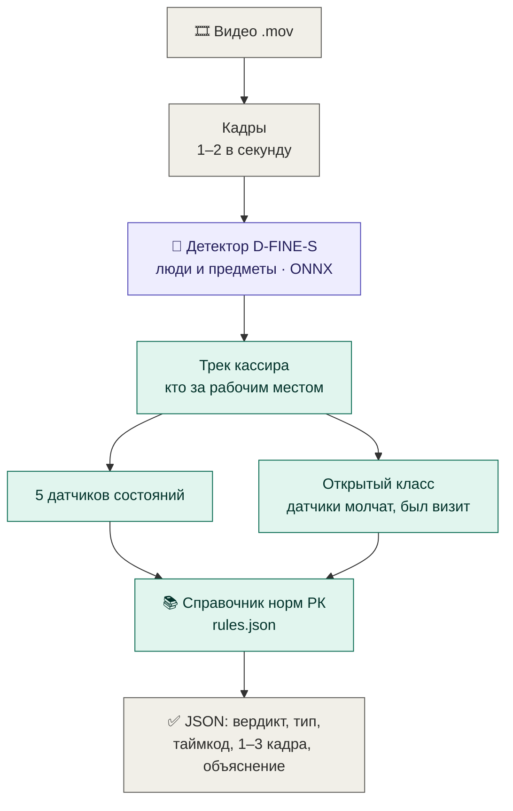
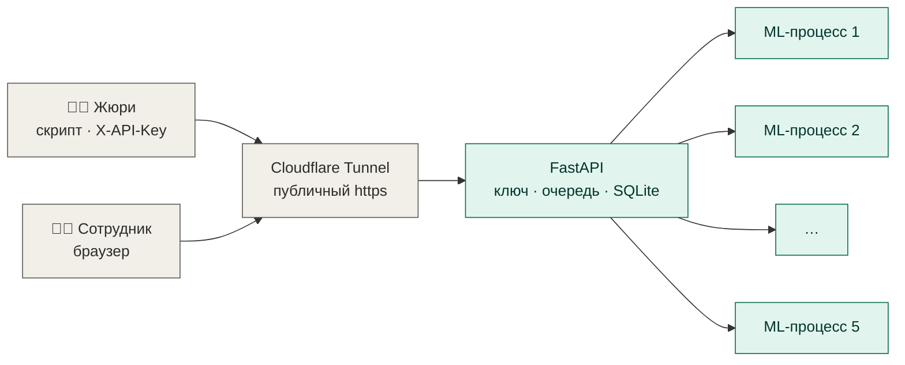
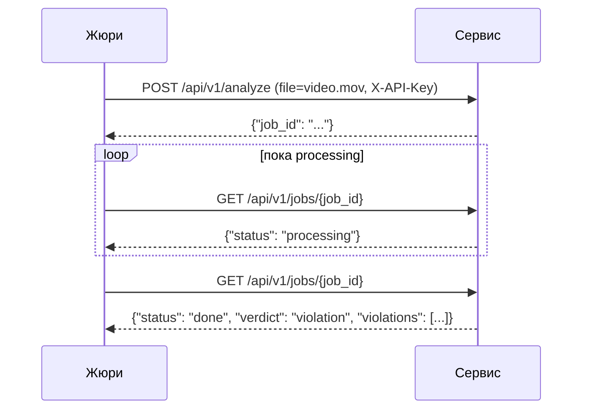

# Видеоконтроль · Контроль кассовых операций

> AI-сервис для **ForteBank** (Datathon '26). По видеозаписи работы кассира находит визуальные признаки возможных нарушений кассовой дисциплины и показывает **момент, кадры-доказательства, понятное объяснение и пункт нормативного акта РК**. Результат — подсказка для проверки человеком, а не юридическое заключение.


---

## Для жюри

| | |
|---|---|
| **Веб-интерфейс** | адрес передан в форме сдачи (после запуска — `tools/PUBLIC_URL.txt`) |
| **API (base URL)** | тот же адрес + `/api/v1` |
| **API-ключ** | передан в форме сдачи; заголовок `X-API-Key` |
| **Окно проверки** | 18.10, 12:00–14:30. Если адрес изменится (перезапуск туннеля), новый будет сообщён организаторам |

Сверка проекта с ТЗ по пунктам — [docs/tz-audit.md](docs/tz-audit.md).

---

## Как это работает

Нарушение на кассе — чаще **состояние или бездействие** (дверь не закрылась, экран остался открытым, ценности лежат без кассира), а не особое движение. Поэтому решение устроено в три уровня: нейросеть говорит, **что** в кадре, объяснимые датчики решают, **что произошло**, справочник норм отвечает, **какое правило** может быть нарушено.



**Ключевое решение — датчики не знают комнату.** Все расстояния считаются в долях роста кассира и ширины ноутбука, без зон, эталонных кадров и калибровки камеры. Поэтому решение не нужно перенастраивать под новый угол или другое помещение.

### Датчики

| Датчик | Тип нарушения | Как видит сервис |
|---|---|---|
| 🚪 Дверь | Дверь кассового помещения не закрыта | место, где появляются люди, — вход; после прохода вид входа не вернулся к исходному |
| 💻 Экран | Признаки незаблокированной рабочей станции при уходе | кассир отошёл, экран в рамке ноутбука остался светлым |
| 🧍 Посторонний | Признаки постороннего лица у рабочего места | двое у кассы, человек вплотную к кассиру или у стола не садится |
| 💵 Ценности | Ценности оставлены на столе без присмотра | кассир ушёл, у его места остался новый предмет |
| 👜 Личные вещи | Личные вещи на рабочем месте кассира | у кассира появилась сумка, стакан или еда, которых не было в начале |
| ❔ Открытый класс | Возможное нарушение порядка работы с ценностями (требуется проверка) | датчики молчат, но в кадре долго находились несколько людей — эвристика против пропусков (ТЗ, FAQ 16) |

Каждое событие в ответе объяснено четырьмя блоками: **что видно**, **почему это важно**, **что проверить**, **норма** со ссылкой на adilet.zan.kz. Нормы не генерируются моделью — они берутся из заранее проверенного справочника, поэтому выдуманных ссылок нет.

---

## Архитектура сервиса



- Каждое видео обрабатывается в отдельном процессе с жёстким лимитом времени; зависший процесс завершается, задача получает `failed`.
- Видео удаляется после обработки; результаты хранятся в SQLite и переживают перезапуск.
- Всё выполняется локально: веса внутри сервиса, после сборки интернет не нужен (`HF_HUB_OFFLINE=1`).

### API в два шага (ТЗ, раздел 10)



<details>
<summary>Пример ответа</summary>

```json
{
  "job_id": "3de4c30eec0f4670bac0fcecdf2aa771",
  "status": "done",
  "verdict": "violation",
  "violations": [
    {
      "type": "Признаки возможной незаблокированной рабочей станции при уходе",
      "timecode_sec": 7.56,
      "description": "Что видно: В 00:07.6 кассир уходит с рабочего места, а экран компьютера остаётся светлым… Почему это важно: … Что проверить: … Норма: …",
      "evidence_frames": [
        { "timestamp_sec": 6.05, "image_base64": "/9j/4AAQ..." },
        { "timestamp_sec": 7.56, "image_base64": "/9j/4AAQ..." },
        { "timestamp_sec": 9.07, "image_base64": "/9j/4AAQ..." }
      ]
    }
  ]
}
```
</details>

---

## Результаты

Оценка — нашим оценщиком по критериям жюри (вердикт, таймкод, тип); это приближение, а не официальный результат.

| | Размеченные ролики (33) | Отложенные (7, не использовались при настройке) |
|---|---|---|
| Найдено нарушений (полный режим) | **17 из 18** | 3 из 3 |
| Ложные тревоги, полный режим | 10 из 15 | 3 из 4 |
| Ложные тревоги, только конкретные датчики | **0 из 15** | 1 из 4 |
| Верный тип среди найденных | 13 из 16 | 1 из 3 |
| Доля баллов, полный режим | **0.69** | 0.42 |

Ложные тревоги полного режима — сознательная цена полноты: ТЗ требует, чтобы пропусков не было. В интерфейсе такие случаи помечены как «тип не определён», режим отключается одной настройкой (`FALLBACK_VISIT_S=0`).

### Устойчивость к другому углу камеры

Финальное видео снято под другим углом, поэтому мы проверили это заранее: исказили все 40 роликов перспективой (смещение углов кадра до 14 %, поворот до 6°, приближение до 12 %), как будто камеру повесили иначе.

| «Только датчики», доля баллов | Исходные | Ракурс A | Ракурс B (проверочный) | Зеркальный ракурс |
|---|---|---|---|---|
| До правок устойчивости | 0.643 | 0.483 | 0.519 | — |
| **После** | **0.643** | **0.576** | **0.596** | 0.535 |

Главная находка — в трекере кассира оставалась пиксельная «линия пола» исходной камеры: на другом ракурсе кассир мог не найтись вовсе. Пороги подбирались на ракурсе A и проверялись на B и зеркальном, которые в подборе не участвовали; на исходных видео ни одна правка качество не снизила. Подробно — [docs/architecture.md](docs/architecture.md).

### Скорость

| Замер | Результат |
|---|---|
| 5 самых длинных видео (143 с, 27 МБ) параллельно через публичный адрес | все готовы, максимум 189 с при лимите 300 |
| Контрактный тест на ноутбуке под нагрузкой | все 5 готовы, максимум 196 с |
| Память | ~0.7 ГБ на ML-процесс |

---

## Быстрый запуск

```bash
# 1. окружение и зависимости — по docs/usage.md, затем один раз собрать модель
python solution/export_onnx.py
# 2. в service/.env задать SERVICE_API_KEY (шаблон — service/.env.example)
# 3. Windows: двойной клик по START_SERVICE.bat
```

`START_SERVICE.bat` откроет окна «сервис» и «туннель»; публичный адрес появится в окне и в `tools/PUBLIC_URL.txt`. Проверка: `<адрес>/health` → `"ready_workers":5`, `<адрес>/api/v1` — справка по API. Памятка на случай сбоев — [tools/RUNBOOK.md](tools/RUNBOOK.md). Docker-вариант для переноса в контур банка — [docs/usage.md](docs/usage.md#запуск-сервиса).

---

## Модели и технологии

| Компонент | Что используем | Лицензия |
|---|---|---|
| Детектор | D-FINE-S, веса COCO (41 МБ), экспорт в ONNX | Apache-2.0 |
| Инференс | ONNX Runtime (CPU); опционально OpenVINO | MIT / Apache-2.0 |
| Видео и изображения | OpenCV, NumPy, Pillow | Apache-2.0 / BSD / HPND |
| Сервис | FastAPI, Uvicorn, Pydantic, SQLite | MIT / BSD / public domain |
| Публичный адрес | Cloudflare Tunnel (`cloudflared`) | Apache-2.0 |

Отклонены по лицензии: Ultralytics YOLO (AGPL-3.0), Qwen2.5-VL-3B (research). Проверены и отклонены по качеству: VLM Qwen3-VL 4B/8B, модель «подозрительности визита» на 59 признаках — все эксперименты в [журнале](research/notes/experiments.md).

---

## Документы к сдаче (ТЗ, раздел 8)

| Требование ТЗ | Документ |
|---|---|
| Инструкция по запуску и использованию | [docs/usage.md](docs/usage.md) |
| Архитектура, подход, модели | [docs/architecture.md](docs/architecture.md) |
| Нормативные источники и принцип сопоставления | [docs/rules.md](docs/rules.md) |
| Перечень распознаваемых типов нарушений | [docs/rules.md](docs/rules.md#распознаваемые-типы) |
| Ограничения и известные ошибки | [docs/limitations.md](docs/limitations.md) |

**Главные ограничения:** телефон в руке на этом разрешении (5–15 пикселей) неотличим от купюр; нарушения процедуры отличаются смыслом, а не картинкой — для них есть только общий тип; при сильной смене ракурса качество снижается. Подробно — [docs/limitations.md](docs/limitations.md).

---

## Структура

```
dataton/
├── START_SERVICE.bat         запуск двойным кликом: сервис + публичный туннель
├── RESTART_SERVICE_ONLY.bat  перезапуск только сервиса (публичный адрес не меняется)
├── service/                  FastAPI, очередь на 5 ML-процессов, веб-интерфейс static/, тесты, Docker
├── solution/                 ML-ядро
│   ├── inference.py              вход для сервиса: Analyzer().run(видео) → JSON
│   ├── pipeline.py               кадры → детектор D-FINE (ONNX) → датчики → ответ с нормами
│   ├── sensors_core.py           трек кассира, 5 датчиков, открытый класс
│   ├── sensors/                  датчики: дверь, экран, посторонний, ценности, личные вещи
│   ├── rules.json                справочник типов: нормы РК и объяснения
│   ├── assets/                   views.json; эталонные кадры (только режим h5) и ONNX-модель — не в git
│   ├── bench.py, evaluate.py     стенд и оценщик по критериям жюри
│   ├── experiments/              отклонённые эксперименты (VLM, поза, модель визита…)
│   └── runs/                     регрессии, тест ракурса, подбор порогов
├── docs/                     документы к сдаче
├── tools/                    запуск на ноутбуке, памятка RUNBOOK.md
└── research/                 заметки, журнал экспериментов, ядра Kaggle
```

Видео, кадры и разметка кейса в репозиторий не включены (ТЗ, FAQ 6: данные используются только в рамках хакатона).
